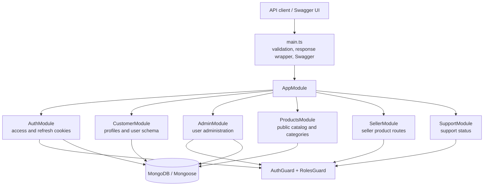

<div align="center">

# NestJS Marketplace API

Role-based multi-vendor marketplace backend built with NestJS, TypeScript, and MongoDB.

[](https://nestjs.com/)
[](https://www.typescriptlang.org/)
[](https://mongoosejs.com/)

</div>

## Overview

This repository contains a modular REST API foundation for a marketplace. It currently includes cookie-based authentication with rotating refresh tokens, role checks, customer profile management, admin user management, seller-owned product operations, public product and category reads, and Swagger UI.

The application uses MongoDB through Mongoose. Responses pass through a global interceptor and are wrapped in the shape `{ statusCode, massage, data }` (the current response key is spelled `massage`).

## Features

- **Authentication:** customer registration, login, logout, current session, 15-minute access cookies, and rotating 7-day refresh cookies.
- **Roles:** `admin`, `customer`, `seller`, and `support`.
- **Customer profiles:** view, update, and deactivate the signed-in account.
- **Admin user management:** list users (excluding the signed-in admin), create users with roles, update users, and delete users.
- **Seller products:** create, list, update, and deactivate products owned by the signed-in seller.
- **Public catalog:** browse active products and categories, and view product details with category and seller names.
- **Swagger:** interactive API documentation at `/api`.
- **Validation:** global request validation rejects unknown fields and validates DTO constraints.

## Requirements

- Node.js compatible with the TypeScript target (ES2023)
- npm
- MongoDB connection URI

## Getting started

```bash
npm install
```

Set these environment variables in a local `.env` file or your runtime environment:

| Variable | Required | Description |
| --- | --- | --- |
| `MONGODB_URI` | Yes | MongoDB URI, such as `mongodb://127.0.0.1:27017/marketplace` |
| `JWT_SECRET` | Production | Secret used to sign access tokens and hash refresh tokens. Use a random value of at least 32 characters. |
| `PORT` | No | HTTP port; defaults to `3000` |
| `NODE_ENV` | No | `development`, `test`, or `production`; defaults to `development` |

Example development `.env`:

```dotenv
NODE_ENV=development
PORT=3000
MONGODB_URI=mongodb://127.0.0.1:27017/marketplace
JWT_SECRET=replace-this-with-a-random-secret-at-least-32-characters
```

`JWT_SECRET` has a development fallback in the current configuration, but set a private, randomly generated value for every deployed environment. The validation schema requires `MONGODB_URI` and requires `JWT_SECRET` in production.

Start the API:

```bash
npm run start:dev
```

Swagger UI is available at [http://localhost:3000/api](http://localhost:3000/api) by default. The API root `GET /` returns a basic health-style greeting.

## API routes

All routes are relative to the server root. Protected routes use the `auth_token` HttpOnly cookie. The refresh and logout routes use the `refresh_token` HttpOnly cookie. Successful login and refresh set or rotate these cookies in the browser.

| Method | Route | Access | Purpose |
| --- | --- | --- | --- |
| `POST` | `/auth/register` | Public | Register a customer |
| `POST` | `/auth/login` | Public | Sign in and set access and refresh cookies |
| `POST` | `/auth/refresh` | Refresh cookie | Rotate refresh token and issue a new access cookie |
| `POST` | `/auth/logout` | Refresh cookie | Revoke refresh token and clear cookies |
| `GET` | `/auth/me` | Authenticated | Read the current session |
| `GET` | `/customer/profile` | Authenticated | View own profile |
| `PATCH` | `/customer/profile` | Authenticated | Update own profile |
| `DELETE` | `/customer/profile` | Authenticated | Deactivate own account |
| `GET` | `/admin/users` | Admin | List other users |
| `POST` | `/admin/users` | Admin | Create a user |
| `PATCH` | `/admin/users/:id` | Admin | Update a user |
| `DELETE` | `/admin/users/:id` | Admin | Delete a user |
| `GET` | `/products` | Public | List active products |
| `GET` | `/products/:id` | Public | Get product details |
| `GET` | `/products/categories` | Public | List active categories |
| `POST` | `/products/categories` | Authenticated | Create a category |
| `GET` | `/seller/products` | Seller | List all products owned by the seller |
| `POST` | `/seller/products` | Seller | Create a product |
| `PATCH` | `/seller/products/:id` | Seller | Update an owned product |
| `DELETE` | `/seller/products/:id` | Seller | Deactivate an owned product |
| `GET` | `/support/status` | Support | Read support role status |

Product records use `name`, `description`, `price`, `stock`, `categoryId`, `sellerId`, and `isActive`. Public product responses expose `categoryName` and `sellerName` in place of the reference IDs.

> **Category access:** `POST /products/categories` currently requires authentication. The controller summary mentions admin/support, but the current route does not apply the role guard; tighten this before relying on role-restricted category creation.

## Role access summary

| Role | Current API capabilities |
| --- | --- |
| `admin` | Admin user management; authenticated category creation |
| `customer` | Own profile operations; public catalog |
| `seller` | Own profile operations; seller product management; public catalog |
| `support` | Support status; authenticated category creation; public catalog |

Registration always creates a customer. Admins can assign other roles through user creation or role updates.

## Architecture



## Project structure

See [structure.md](./structure.md) for the file-by-file layout and module responsibilities.

## Scripts

| Command | Description |
| --- | --- |
| `npm run start` | Start the app |
| `npm run start:dev` | Start in watch mode |
| `npm run start:debug` | Start in debug/watch mode |
| `npm run start:prod` | Run the compiled app from `dist/` |
| `npm run build` | Compile the app |
| `npm run lint` | Lint source and tests with Oxlint |
| `npm run test` | Run unit tests with Vitest |
| `npm run test:e2e` | Run end-to-end tests |
| `npm run test:cov` | Run tests with coverage |
| `npm run format` | Format source and test TypeScript files |

## Tests

Run the test suites with:

```bash
npm run test
npm run test:e2e
```

The end-to-end test imports the application module, so it needs a reachable MongoDB instance and the required environment variables.

## Observability

The project includes `@nestjs/observe` instrumentation setup. Connecting an Observe account is optional; configure the Observe app credentials and enable the `ObserveModule` setup in `src/app.module.ts` when observability is needed.

## Current scope

Authentication, customer, admin, seller, support, product, and category features are present. Marketplace areas such as carts, checkout, orders, payments, inventory, shipping, reviews, and coupons are not implemented in the current source tree.


