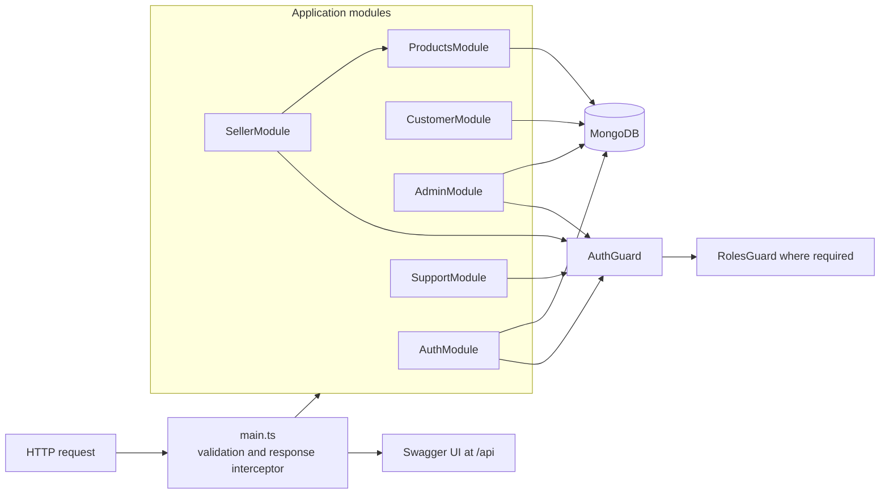

# Repository Structure

This document describes the files and modules currently present in the repository. Planned marketplace areas are listed separately at the end and are not part of the current source tree.

## Architecture diagram



## Source tree

```text
.
├── src/
│   ├── app.controller.ts
│   ├── app.module.ts
│   ├── app.service.ts
│   ├── main.ts
│   ├── config/
│   │   ├── configuration.ts
│   │   └── validation.schema.ts
│   ├── database/
│   │   └── database.module.ts
│   ├── guards/
│   │   ├── auth.guard.ts
│   │   └── roles.guard.ts
│   ├── modules/
│   │   ├── admin/
│   │   │   ├── admin.controller.ts
│   │   │   ├── admin.module.ts
│   │   │   ├── admin.service.ts
│   │   │   └── types.ts
│   │   ├── auth/
│   │   │   ├── auth.controller.ts
│   │   │   ├── auth.module.ts
│   │   │   ├── auth.service.ts
│   │   │   └── types.ts
│   │   ├── customer/
│   │   │   ├── customer.controller.ts
│   │   │   ├── customer.module.ts
│   │   │   ├── customer.service.ts
│   │   │   ├── types.ts
│   │   │   └── user.schema.ts
│   │   ├── products/
│   │   │   ├── category.schema.ts
│   │   │   ├── product.schema.ts
│   │   │   ├── products.controller.ts
│   │   │   ├── products.module.ts
│   │   │   ├── products.service.ts
│   │   │   └── types.ts
│   │   ├── seller/
│   │   │   ├── seller.controller.ts
│   │   │   └── seller.module.ts
│   │   └── support/
│   │       ├── support.controller.ts
│   │       └── support.module.ts
│   └── utils/
│       ├── transform.interceptor.ts
│       └── transform.interceptor.spec.ts
├── test/
│   └── app.e2e-spec.ts
├── nest-cli.json
├── package.json
├── package-lock.json
├── tsconfig.build.json
├── tsconfig.json
├── vitest.config.e2e.ts
├── vitest.config.ts
├── README.md
└── structure.md
```

## Root and application files

Swagger DTO files are also part of the feature modules: `src/modules/auth/auth.dto.ts`, `src/modules/admin/admin.dto.ts`, `src/modules/customer/customer.dto.ts`, and `src/modules/products/products.dto.ts`. They use the `.dto.ts` suffix configured in `nest-cli.json` so the Swagger plugin can generate schemas from class-validator decorators and comments.

| Path | Responsibility |
| --- | --- |
| `src/main.ts` | Creates the Nest application, installs global validation and response wrapping, configures Swagger at `/api`, and starts the HTTP server. |
| `src/app.module.ts` | Root module: configures environment loading and imports database and feature modules. |
| `src/app.controller.ts` | Handles the root `GET /` endpoint. |
| `src/app.service.ts` | Provides the root greeting used by `AppController`. |
| `src/config/configuration.ts` | Maps environment variables into application configuration. |
| `src/config/validation.schema.ts` | Validates `NODE_ENV`, `PORT`, `MONGODB_URI`, and production `JWT_SECRET`. |
| `src/database/database.module.ts` | Configures the Mongoose connection. |
| `src/guards/auth.guard.ts` | Reads the access cookie, validates the signed session, and checks account activity. |
| `src/guards/roles.guard.ts` | Checks role metadata for protected controllers and handlers. |
| `src/utils/transform.interceptor.ts` | Wraps successful endpoint results in the common response object. |
| `src/utils/transform.interceptor.spec.ts` | Unit tests for the response interceptor. |
| `test/app.e2e-spec.ts` | End-to-end test for the root endpoint. |
| `vitest.config.ts` | Vitest configuration for unit tests. |
| `vitest.config.e2e.ts` | Vitest configuration for end-to-end tests. |
| `tsconfig.json`, `tsconfig.build.json` | TypeScript compiler settings. |
| `nest-cli.json` | Nest CLI configuration. |
| `package.json`, `package-lock.json` | Dependencies and npm scripts. |

## Feature modules

### Authentication — `src/modules/auth/`

- `auth.controller.ts` exposes registration, login, refresh, logout, and current-session routes.
- `auth.service.ts` handles password hashing, signed access tokens, hashed refresh-token persistence, rotation, revocation, and session validation.
- `auth.module.ts` registers the auth service and exports the auth guard for other modules.
- `auth.dto.ts` contains login and registration DTOs. The `.dto.ts` suffix enables Swagger plugin schema generation.

Access cookies last 15 minutes. Refresh cookies last 7 days and are rotated on refresh. The refresh-token hash and expiry are stored on the user document.

### Customer — `src/modules/customer/`

- `user.schema.ts` defines user records, roles, account activity, and refresh-token fields.
- `customer.controller.ts` exposes signed-in profile read/update/deactivation routes.
- `customer.service.ts` performs profile operations on the authenticated user.
- `customer.module.ts` registers and exports the user model and customer service.
- `types.ts` defines shared role/session types; `customer.dto.ts` contains profile update validation and OpenAPI field documentation.

Roles are `admin`, `customer`, `seller`, and `support`. Public registration creates customer accounts.

### Admin — `src/modules/admin/`

- `admin.controller.ts` exposes admin-only user listing, creation, update, and deletion.
- `admin.service.ts` implements user CRUD and password hashing for admin-created users.
- `admin.module.ts` imports the customer model provider.
- `admin.dto.ts` contains create/update user validation and OpenAPI field documentation.

The list excludes the currently authenticated admin.

### Products and categories — `src/modules/products/`

- `products.controller.ts` exposes public product/category reads and category creation.
- `products.service.ts` performs catalog, category, and product operations and shapes public product responses with category and seller names.
- `products.module.ts` registers product/category schemas and exports the product service for the seller module.
- `product.schema.ts` defines product data and seller/category references.
- `category.schema.ts` defines category data.
- `products.dto.ts` contains product/category validation and OpenAPI field documentation; `types.ts` contains the product document type.

Public product reads return active products. The category creation route currently requires authentication; the controller documentation mentions admin/support, but the route does not currently add a role guard.

### Seller — `src/modules/seller/`

- `seller.controller.ts` exposes seller product listing, creation, update, and deactivation routes under `/seller/products`.
- `seller.module.ts` imports auth and product providers, registers the controller, and applies role-guard support.

All seller operations require a valid access cookie and the `seller` role. Product edits are restricted to products owned by that seller.

### Support — `src/modules/support/`

- `support.controller.ts` exposes `GET /support/status` to support users.
- `support.module.ts` registers the controller and guards.

## Runtime request flow

1. `main.ts` creates the Nest app, validates DTOs globally, and registers the response interceptor and Swagger UI.
2. `AppModule` loads configuration and wires feature modules.
3. A feature controller receives the request. Protected routes pass through `AuthGuard`; role-scoped routes also pass through `RolesGuard`.
4. Feature services use Mongoose models registered by the feature modules.
5. Successful results are returned through `TransformInterceptor`.

## Present versus planned scope

The source currently implements auth, customer profiles, admin user management, seller product operations, product/category catalog routes, and a support status endpoint. There are no source modules yet for stores, seller onboarding, inventory, search, cart, checkout, orders, payments, shipping, reviews, coupons, or notifications.
